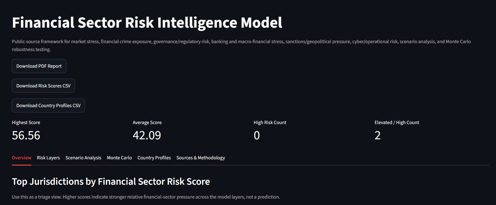
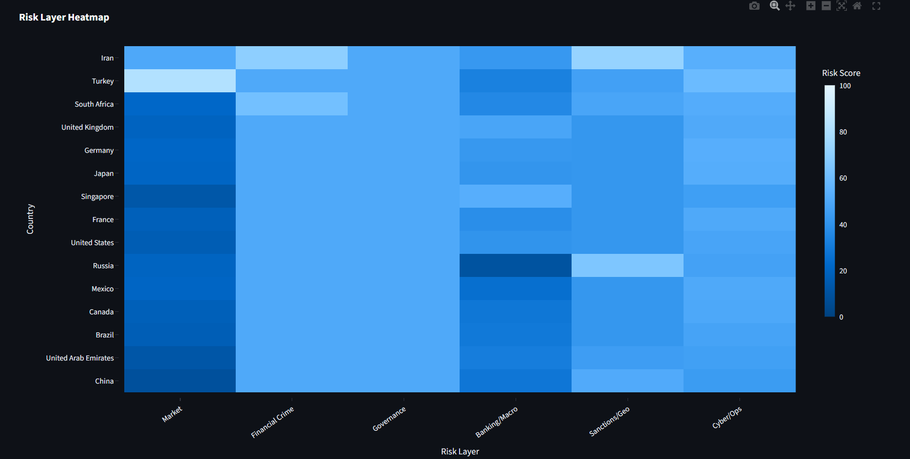
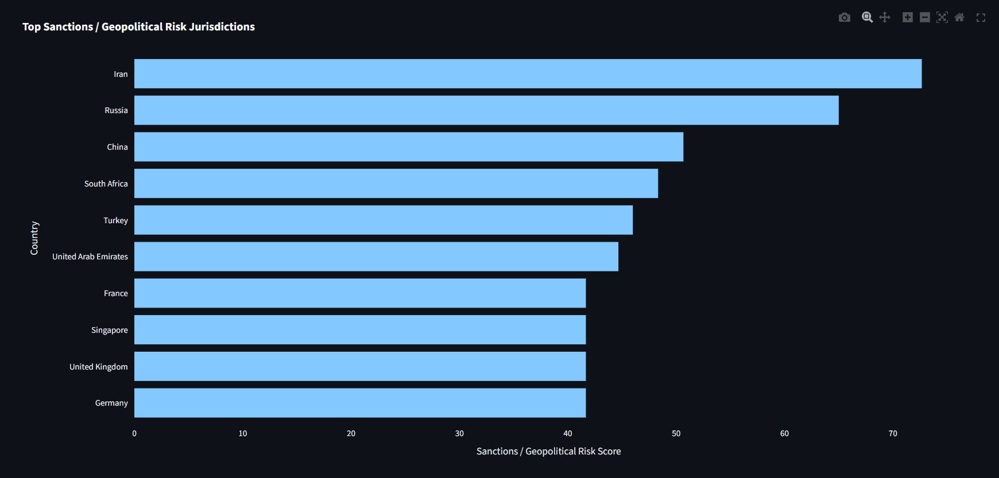
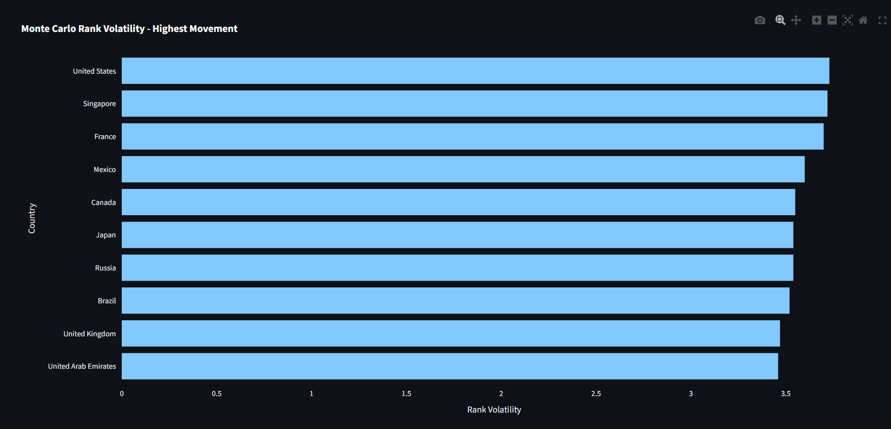
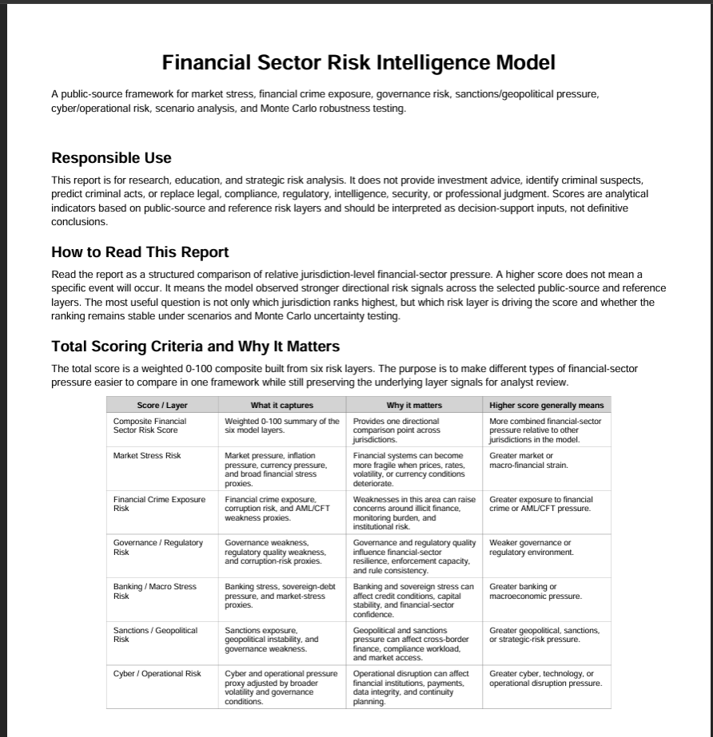

# Financial Sector Risk Intelligence Model

A standalone public-source financial-sector risk intelligence framework for jurisdiction-level strategic risk analysis.

This project combines live public data, authenticated event data, reference risk layers, scenario analysis, Monte Carlo robustness testing, visualizations, a PDF report, and a Streamlit dashboard to support structured review of financial-sector risk conditions across selected jurisdictions.

## Responsible Use

This project is for research, education, and strategic risk analysis.

It does **not**:

- Provide investment advice
- Identify criminal suspects
- Predict criminal acts
- Replace legal, compliance, regulatory, intelligence, security, or professional judgment
- Provide tactical targeting or operational recommendations

All outputs should be interpreted as directional risk indicators for analyst review, not definitive findings.

## Project Overview

The model evaluates jurisdiction-level financial-sector risk across several risk layers:

- Market stress
- Financial crime exposure
- Governance and regulatory weakness
- Banking and macroeconomic stress
- Sanctions and geopolitical exposure
- Cyber and operational pressure

The model then produces:

- A composite financial-sector risk score
- Risk-band classifications
- Primary risk-driver labels
- Country profile tables
- Regional risk-layer summaries
- Scenario analysis
- Monte Carlo robustness testing
- Charts
- A PDF report
- A Streamlit dashboard
- Live-source status diagnostics

## Screenshots

### Dashboard Overview



### Risk Layer Heatmap



### Sanctions / Geopolitical Risk Layer



### Monte Carlo Rank Volatility



### PDF Report Scoring Criteria



## Current Data Layers

### World Bank API

Used for live macroeconomic and governance indicators, including inflation, GDP growth, government debt, regulatory quality, rule of law, control of corruption, and political stability.

### FATF / Sanctions Reference Layer

Adds AML/CFT and sanctions-related jurisdictional adjustments using a public-reference approach. This layer is intended for broad jurisdictional risk context and should be reviewed before publication or operational use.

### Market Data Connector

Uses public market proxies to estimate broad financial-market stress, banking pressure, volatility, and dollar-pressure signals.

### ACLED Live Event Data

Uses authenticated ACLED access to pull recent political violence, protest, fatality, and geographic-spread indicators. The model aggregates this data at the country level only.

### Manual Seed Dataset

Provides manually assigned demonstration inputs only when `--demo` is explicitly selected. Live World Bank failures stop the run instead of silently substituting seed values.

## Methodology

The model uses directional 0-100 proxy scores, where:

- `0` indicates lower observed or proxy risk
- `100` indicates higher observed or proxy risk

Each jurisdiction receives layer-level risk scores. These are combined into a composite financial-sector risk score using weighted aggregation.

### Composite Score Layers

| Layer | Purpose |
|---|---|
| Market Stress Risk | Captures market pressure, inflation pressure, currency pressure, and broad financial stress proxies. |
| Financial Crime Exposure Risk | Captures financial crime exposure, corruption risk, and AML/CFT weakness proxies. |
| Governance / Regulatory Risk | Captures governance weakness, regulatory quality weakness, and corruption-risk proxies. |
| Banking / Macro Stress Risk | Captures banking stress, sovereign-debt pressure, and market-stress proxies. |
| Sanctions / Geopolitical Risk | Captures sanctions exposure, geopolitical instability, and governance weakness. |
| Cyber / Operational Risk | Captures cyber and operational pressure proxy signals. |

### Scenario Analysis

Scenario analysis tests how scores change under different stress assumptions, such as increased market stress, sanctions/geopolitical pressure, financial crime exposure, cyber disruption, banking stress, and broader geopolitical crisis conditions.

These scenarios are not forecasts. They are structured stress tests that help compare how the model behaves under different assumptions.

### Monte Carlo Robustness Testing

Monte Carlo simulation adds controlled random variation to test score and rank stability. This helps show whether a jurisdiction's ranking is stable or sensitive to uncertainty in the input assumptions.

The model outputs Monte Carlo summary fields such as:

- Mean simulated score
- Standard deviation of simulated score
- Mean simulated rank
- Best and worst simulated rank
- Rank volatility
- Elevated-or-high probability

### Source Status Diagnostics

The project generates a live-source status table showing whether key data outputs are available, missing, empty, or fallback-based.

## Outputs

The pipeline generates the following main outputs.

### Tables

Located in:

```text
outputs/tables/
```

Key files include:

```text
financial_sector_risk_scores.csv
country_financial_risk_profiles.csv
risk_layer_summary.csv
source_register.csv
live_source_status.csv
fatf_sanctions_reference.csv
market_metrics.csv
market_stress_signal.csv
acled_country_signals.csv
scenario_results.csv
scenario_summary.csv
monte_carlo_results.csv
monte_carlo_summary.csv
```

### Raw and Processed Data

Located in:

```text
data/raw/
data/processed/
```

Key files include:

```text
live_financial_risk_dataset.csv
market_history.csv
acled_events_90d.csv
processed_financial_sector_risk_data.csv
```

### Charts

Located in:

```text
outputs/charts/
```

Key charts include:

```text
top_10_financial_sector_risk_countries.png
risk_layer_heatmap.png
market_vs_financial_crime_risk.png
governance_vs_sanctions_risk.png
monte_carlo_score_distribution.png
monte_carlo_rank_stability.png
monte_carlo_rank_volatility.png
```

### Report

Located in:

```text
outputs/reports/
```

Main report:

```text
financial_sector_risk_report.pdf
```

## Project Structure

```text
financial-sector-risk-intelligence-model/
│
├── app.py
├── main.py
├── requirements.txt
├── README.md
├── .gitignore
│
├── assets/
│   └── screenshots/
│       ├── dashboard_overview.png
│       ├── risk_layer_heatmap.png
│       ├── sanctions_geopolitical_risk.png
│       ├── monte_carlo_rank_volatility.png
│       └── pdf_report_scoring_criteria.png
│
├── src/
│   ├── __init__.py
│   ├── acled_live.py
│   ├── config.py
│   ├── data_sources.py
│   ├── fatf_sanctions.py
│   ├── market_data.py
│   ├── monte_carlo.py
│   ├── outputs.py
│   ├── report_generator.py
│   ├── scenarios.py
│   ├── scoring.py
│   ├── source_status.py
│   ├── visualization.py
│   └── world_bank_live.py
│
├── data/
│   ├── raw/
│   └── processed/
│
└── outputs/
    ├── charts/
    ├── reports/
    └── tables/
```

## Setup

Create and activate a virtual environment:

```powershell
python -m venv .venv
.venv\Scripts\activate
```

Install dependencies:

```powershell
pip install -r requirements.txt
```

Create a `.env` file in the project root if using ACLED:

```env
ACLED_USERNAME=your_username_here
ACLED_PASSWORD=your_password_here
```

Do not commit `.env` to GitHub.

## Running the Pipeline

Run the full model pipeline:

```powershell
python main.py
```

This generates tables, charts, raw and processed data, simulations, source-status diagnostics, and the PDF report. Live mode requires a successful World Bank pull. An ACLED failure leaves the valid macro inputs intact and applies no event adjustment. Market-source fallback scoring remains unchanged and is labeled in the source status.

Run an explicitly labeled, fully offline demonstration:

```powershell
python main.py --demo
```

`build_financial_risk_dataset(use_live_data=False)` also makes no network requests. Demo outputs overwrite the usual output paths and carry `data_mode=demonstration`; the PDF includes a demonstration notice.

The pipeline fetches each connector once and saves that exact evidence. Source diagnostics are generated after the current run's outputs, with source status separate from file availability. A populated file is not proof of live data.

The dashboard now reads `outputs/tables/run_snapshot.zip`, an atomic snapshot of the completed run's tables and PDF, verified against `run_status.json`. It displays and downloads the same bytes without a filename-only cache. A running, failed, interrupted, corrupt, or legacy run without a completed snapshot is not displayed. After upgrading, regenerate outputs once. Loose CSVs and PDFs are pipeline working artifacts and may be partial after a failure; downstream consumers should use the verified snapshot through `src.publication.read_snapshot`.

Concurrent pipeline writers are refused by `outputs/tables/.pipeline.lock`. Normal exceptions release the lock and mark the run failed. After a hard process termination, confirm that no pipeline process is still running before manually removing the lock and rerunning. The previous archive is preserved on failures before replacement, but is not presented as the current run.

ACLED uses [cursor pagination](https://acleddata.com/api-documentation/elements-acleds-api), checks completion and reported totals, deduplicates event IDs, and rejects conflicting records, stalled cursors, and invalid country/date coverage. Countries absent from a response remain coverage-unverified rather than being assigned zero event risk. No authenticated live ACLED validation is implied by the offline tests.

World Bank indicator values and individual observation years are retained. Existing missing-value substitutions, scaling, weights, risk thresholds, reference values, scenario multipliers, and simulation assumptions are unchanged; their methodological review remains a later phase. The primary-driver label now uses weighted contribution. Missing/nonfinite scores are labeled `Unknown`, and layer means no longer silently skip missing components.

Unknown/nonfinite model scores are rejected before ranking, scenarios, and Monte Carlo simulation. ACLED fatality values must be numeric, finite, and nonnegative; invalid values cause the event layer to be unavailable rather than being treated as observed zeros.

## Regression Tests

```powershell
pip install -r requirements-dev.txt
python -m pytest -q
```

Tests use synthetic/mocked responses with network access blocked. They cover source failures, offline mode, pagination/completeness, missing coverage, weighted drivers, missing scores, indicator years, single-fetch exports, first/repeated-run diagnostics, baseline scenario equivalence, and seeded simulation reproducibility.

Additional regressions cover invalid ACLED fatality values, invalid downstream scoring inputs, failed/interrupted publication, concurrent writers, archive corruption and run mismatch, snapshot-write failure, and Streamlit refresh/download consistency.

## Running the Dashboard

Run the Streamlit dashboard:

```powershell
streamlit run app.py
```

## GitHub Safety Notes

Before pushing this project to GitHub:

- Confirm `.env` is not committed
- Confirm ACLED credentials are not present in code, outputs, terminal logs, screenshots, notebooks, or README files
- Confirm `data/raw/`, `data/processed/`, and `outputs/` are excluded if the repository should only contain source code and public documentation
- Review FATF/sanctions reference logic before publication
- Clearly describe that this is a research model and not an operational compliance system

Recommended `.gitignore` entries:

```gitignore
.env
.venv/
.venv-*/
__pycache__/
*.pyc
data/raw/
data/processed/
outputs/
*.log
```

## Limitations

This model uses public-source and reference indicators as proxies. It does not prove causation, identify unlawful behavior, predict specific events, or provide compliance determinations.

Key limitations include:

- Data availability varies by country and source
- Public-source data may lag real-world developments
- Market proxies may reflect broad stress rather than country-specific financial-sector conditions
- ACLED event data is aggregated and should not be interpreted as tactical forecasting
- FATF/sanctions reference layers require periodic review
- Model weights are analyst-defined and should be tested before applied use
- Scores are directional indicators and should be reviewed alongside source context

## Future Development

Potential future improvements include:

- OpenSanctions or OFAC aggregation layer
- Better country-specific financial-market indicators
- Automated FATF reference refresh workflow
- Expanded live-source diagnostics
- More detailed sensitivity analysis
- Historical backtesting
- Expanded country coverage
- Unit tests
- GitHub Actions validation workflow

## License

This project is intended for research and educational use. Add a license file before public release if publishing on GitHub.
