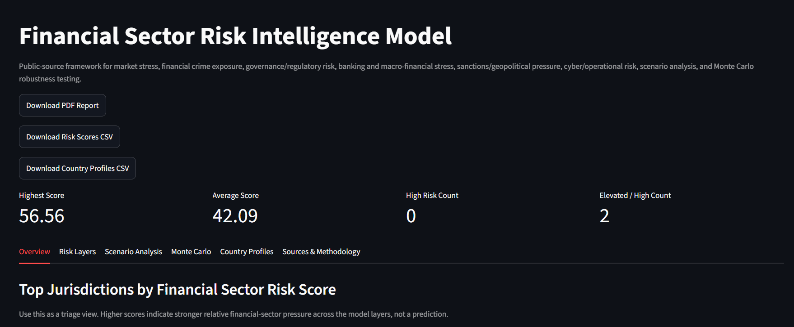
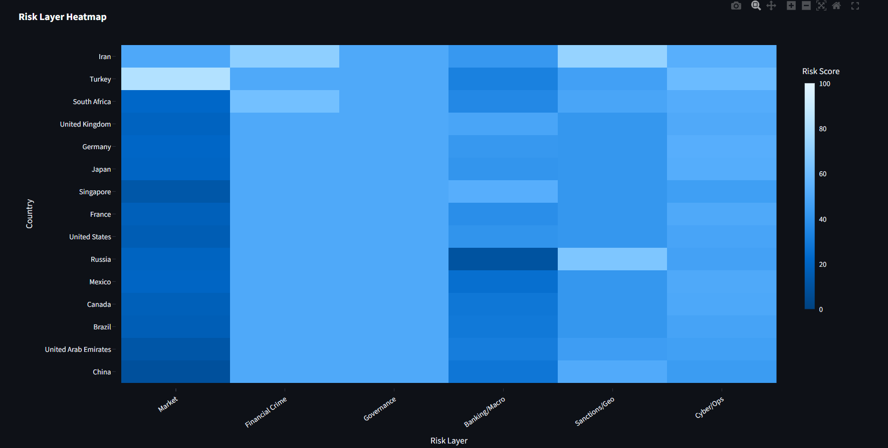
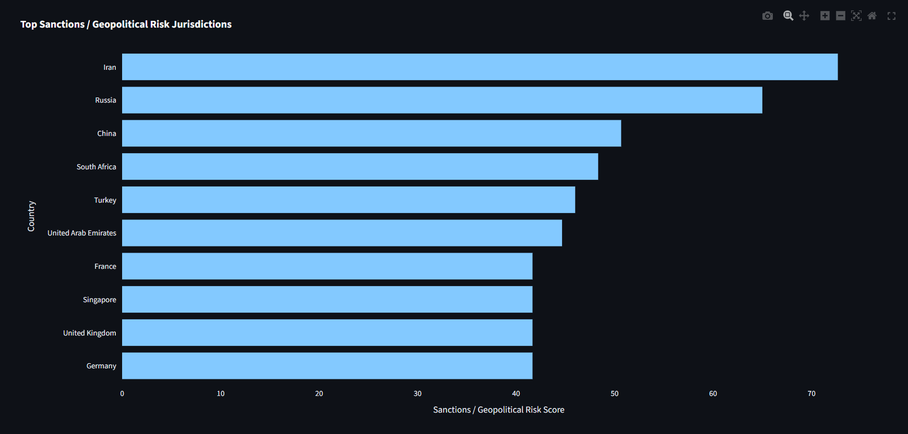
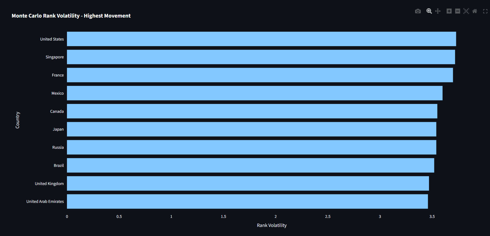
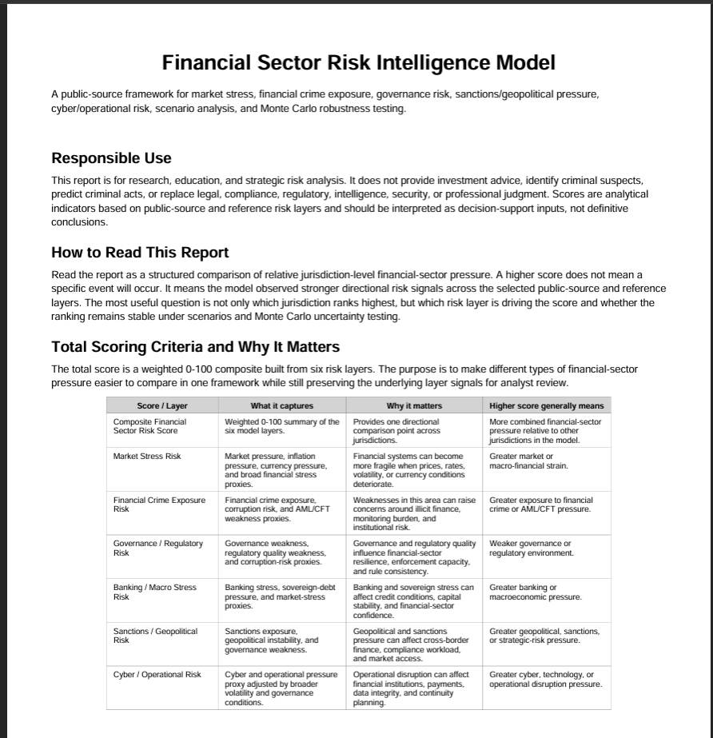

# Financial Sector Risk Intelligence Model

A standalone public-source financial-sector risk intelligence framework for jurisdiction-level strategic risk analysis.

This project combines live public data, authenticated event data, reference risk layers, scenario analysis, Monte Carlo robustness testing, visualizations, a PDF report, and a Streamlit dashboard to support structured review of financial-sector risk conditions across selected jurisdictions.

## Reproduction and validation status

Evidence reviewed November 18, 2026. The offline synthetic demonstration is tested separately from the live-data pipeline. Software checks do not establish empirical model validity.

| Item | Status and evidence |
| --- | --- |
| Environment | Python 3.14.4 with exact runtime and transitive pins in [requirements.txt](requirements.txt); test dependencies in [requirements-dev.txt](requirements-dev.txt). Automated checks target Windows and Ubuntu; inspect the [latest workflow results](https://github.com/jasonrkeen/financial-sector-risk-intelligence-model/actions/workflows/tests.yml) for execution status. |
| Offline reproduction | [Bundled fictional inputs](data/sample/README.md), seed 42, 1,000 draws, noise standard deviation 7.5. One command generates six CSVs, a chart, a sample PDF, and a manifest with input, code, dependency-file, and output hashes. Repeated files are tested for byte equality within the same environment. |
| Verification | [28 test cases](tests/) cover hand-calculated scores, risk-band boundaries, clipping, scenarios, simulation invariants, repeatability, network isolation, and output protection. [Validation scope](docs/VALIDATION.md) records what this evidence establishes. |
| Preserved model | Existing `main.py` and all pre-existing `src/` files are checked against [baseline source hashes](tests/preserved_source_hashes.json) from revision `7e4c452`. Scoring logic, published screenshots, and releases are unchanged. New dependency pins do not retrospectively reproduce historical outputs. |
| Live inputs and access | Live-source requests, manual references, and fallback proxies are not a frozen input vintage. Network access and ACLED credentials are required for the relevant live sources. The [FATF/sanctions layer](src/fatf_sanctions.py) records June 15, 2026 as its review date, not a current sanctions-status certification. |
| Live run and outputs | `python main.py` writes to fixed `outputs/tables/`, `outputs/charts/`, and `outputs/reports/` paths. Use a separate working copy to preserve existing local outputs. This live pipeline and dashboard have not been validated by the offline checks; inspect source-status diagnostics and fallback warnings. |
| Validation limits | Scores are analyst-defined proxies. Simulation band shares measure sensitivity to perturbations, not event probabilities. Predictive validity, calibrated probabilities, and independent reproduction remain unestablished. See [Limitations](#limitations). |

## Deterministic offline sample

Use Python 3.14.4 in an activated virtual environment (see [Setup](#setup)):

```bash
python -m pip install -r requirements.txt
python -m src.sample_run
```

The sample makes no network requests and requires no credentials. It calls the existing scoring, scenario, and Monte Carlo functions with four explicitly fictional jurisdictions:

| Jurisdiction | Expected score | Band |
| --- | ---: | --- |
| Synthetic Delta | 90 | High |
| Synthetic Gamma | 65 | Elevated |
| Synthetic Beta | 40 | Moderate |
| Synthetic Alpha | 10 | Low |

Outputs go to `outputs/sample/`. The command refuses to overwrite an existing directory. For a second run, choose a new directory:

```bash
python -m src.sample_run --output-dir outputs/sample/repeat --seed 42 --simulations 1000
```

Relative output paths are resolved from the repository root. Within the repository, only destinations under `outputs/sample/` are allowed. A new external directory is also supported. The manifest records settings and environment; byte equality is promised only within the same recorded environment, not across operating systems or library versions. These sample artifacts are separate from the live report and published screenshots.

### Automated checks

```bash
python -m pip install -r requirements-dev.txt
python -m pip check
python -m pytest -q
```

[GitHub Actions](.github/workflows/tests.yml) runs dependency checks, the test suite, and the full 1,000-draw sample on pushes and pull requests, on Windows and Ubuntu. Each successful job uploads its synthetic artifacts and manifest. Tests block network connections, including separate-process sample runs. The workflow also checks that tracked files remain unchanged.

## Responsible Use

This project is for research, education, and strategic risk analysis.

It does **not**:

- Provide investment advice
- Identify criminal suspects
- Predict criminal acts
- Replace legal, compliance, regulatory, intelligence, security, or professional judgment
- Provide tactical targeting or operational recommendations

All outputs should be interpreted as directional risk indicators for analyst review, not definitive findings.

## Project Overview

The model evaluates jurisdiction-level financial-sector risk across several risk layers:

- Market stress
- Financial crime exposure
- Governance and regulatory weakness
- Banking and macroeconomic stress
- Sanctions and geopolitical exposure
- Cyber and operational pressure

The model then produces:

- A composite financial-sector risk score
- Risk-band classifications
- Primary risk-driver labels
- Country profile tables
- Regional risk-layer summaries
- Scenario analysis
- Monte Carlo robustness testing
- Charts
- A PDF report
- A Streamlit dashboard
- Live-source status diagnostics

## Screenshots

### Dashboard Overview



### Risk Layer Heatmap



### Sanctions / Geopolitical Risk Layer



### Monte Carlo Rank Volatility



### PDF Report Scoring Criteria



## Current Data Layers

### World Bank API

Used for live macroeconomic and governance indicators, including inflation, GDP growth, government debt, regulatory quality, rule of law, control of corruption, and political stability.

### FATF / Sanctions Reference Layer

Adds AML/CFT and sanctions-related jurisdictional adjustments using a public-reference approach. This layer is intended for broad jurisdictional risk context and should be reviewed before publication or operational use.

### Market Data Connector

Uses public market proxies to estimate broad financial-market stress, banking pressure, volatility, and dollar-pressure signals.

### ACLED Live Event Data

Uses authenticated ACLED access to pull recent political violence, protest, fatality, and geographic-spread indicators. The model aggregates this data at the country level only.

### Manual Seed Dataset

Provides a fallback dataset so the pipeline can continue running if live data sources are unavailable.

## Methodology

The model uses directional 0-100 proxy scores, where:

- `0` indicates lower observed or proxy risk
- `100` indicates higher observed or proxy risk

Each jurisdiction receives layer-level risk scores. These are combined into a composite financial-sector risk score using weighted aggregation.

### Composite Score Layers

| Layer | Purpose |
|---|---|
| Market Stress Risk | Captures market pressure, inflation pressure, currency pressure, and broad financial stress proxies. |
| Financial Crime Exposure Risk | Captures financial crime exposure, corruption risk, and AML/CFT weakness proxies. |
| Governance / Regulatory Risk | Captures governance weakness, regulatory quality weakness, and corruption-risk proxies. |
| Banking / Macro Stress Risk | Captures banking stress, sovereign-debt pressure, and market-stress proxies. |
| Sanctions / Geopolitical Risk | Captures sanctions exposure, geopolitical instability, and governance weakness. |
| Cyber / Operational Risk | Captures cyber and operational pressure proxy signals. |

### Scenario Analysis

Scenario analysis tests how scores change under different stress assumptions, such as increased market stress, sanctions/geopolitical pressure, financial crime exposure, cyber disruption, banking stress, and broader geopolitical crisis conditions.

These scenarios are not forecasts. They are structured stress tests that help compare how the model behaves under different assumptions.

### Monte Carlo Robustness Testing

Monte Carlo results describe score and ranking sensitivity under the specified input perturbations. Reported high-risk shares measure how often simulated scores cross the model's thresholds; they are not estimated probabilities of financial crime, institutional failure, or future events.

Monte Carlo simulation adds controlled random variation to test score and rank stability. This helps show whether a jurisdiction's ranking is stable or sensitive to uncertainty in the input assumptions.

The model outputs Monte Carlo summary fields such as:

- Mean simulated score
- Standard deviation of simulated score
- Mean simulated rank
- Best and worst simulated rank
- Rank volatility
- Share of simulated draws in the elevated or high band (stored as `elevated_or_high_probability`)

### Source Status Diagnostics

The project generates a live-source status table showing whether key data outputs are available, missing, empty, or fallback-based.

## Outputs

The pipeline generates the following main outputs.

### Tables

Located in:

```text
outputs/tables/
```

Key files include:

```text
financial_sector_risk_scores.csv
country_financial_risk_profiles.csv
risk_layer_summary.csv
source_register.csv
live_source_status.csv
fatf_sanctions_reference.csv
market_metrics.csv
market_stress_signal.csv
acled_country_signals.csv
scenario_results.csv
scenario_summary.csv
monte_carlo_results.csv
monte_carlo_summary.csv
```

### Raw and Processed Data

Located in:

```text
data/raw/
data/processed/
```

Key files include:

```text
live_financial_risk_dataset.csv
market_history.csv
acled_events_90d.csv
processed_financial_sector_risk_data.csv
```

### Charts

Located in:

```text
outputs/charts/
```

Key charts include:

```text
top_10_financial_sector_risk_countries.png
risk_layer_heatmap.png
market_vs_financial_crime_risk.png
governance_vs_sanctions_risk.png
monte_carlo_score_distribution.png
monte_carlo_rank_stability.png
monte_carlo_rank_volatility.png
```

### Report

Located in:

```text
outputs/reports/
```

Main report:

```text
financial_sector_risk_report.pdf
```

## Project Structure

```text
financial-sector-risk-intelligence-model/
│
├── app.py
├── main.py
├── requirements.txt
├── README.md
├── .gitignore
│
├── assets/
│   └── screenshots/
│       ├── dashboard_overview.png
│       ├── risk_layer_heatmap.png
│       ├── sanctions_geopolitical_risk.png
│       ├── monte_carlo_rank_volatility.png
│       └── pdf_report_scoring_criteria.png
│
├── src/
│   ├── __init__.py
│   ├── acled_live.py
│   ├── config.py
│   ├── data_sources.py
│   ├── fatf_sanctions.py
│   ├── market_data.py
│   ├── monte_carlo.py
│   ├── outputs.py
│   ├── report_generator.py
│   ├── scenarios.py
│   ├── scoring.py
│   ├── source_status.py
│   ├── visualization.py
│   └── world_bank_live.py
│
├── data/
│   ├── raw/
│   └── processed/
│
└── outputs/
    ├── charts/
    ├── reports/
    └── tables/
```

## Setup

Use Python 3.14.4. Create and activate a virtual environment (Windows PowerShell):

```powershell
python -m venv .venv
.venv\Scripts\activate
```

On Linux/macOS, activate with `source .venv/bin/activate`. Install dependencies:

```powershell
pip install -r requirements.txt
```

For the live ACLED connector, copy [.env.example](.env.example) to an uncommitted `.env` and fill in your credentials:

```env
ACLED_USERNAME=your_username_here
ACLED_PASSWORD=your_password_here
```

Do not commit `.env` to GitHub.

## Running the Pipeline

Run the full model pipeline:

```powershell
python main.py
```

This will generate updated tables, charts, raw data files, processed data files, Monte Carlo outputs, scenario outputs, source-status diagnostics, and the PDF report.

## Running the Dashboard

Run the Streamlit dashboard:

```powershell
streamlit run app.py
```

## GitHub Safety Notes

Before pushing this project to GitHub:

- Confirm `.env` is not committed
- Confirm ACLED credentials are not present in code, outputs, terminal logs, screenshots, notebooks, or README files
- Confirm `data/raw/`, `data/processed/`, and `outputs/` are excluded if the repository should only contain source code and public documentation
- Review FATF/sanctions reference logic before publication
- Clearly describe that this is a research model and not an operational compliance system

Recommended `.gitignore` entries:

```gitignore
.env
.venv/
.venv-*/
__pycache__/
*.pyc
data/raw/
data/processed/
outputs/
*.log
```

## Limitations

This model uses public-source and reference indicators as proxies. It does not prove causation, identify unlawful behavior, predict specific events, or provide compliance determinations.

Key limitations include:

- Data availability varies by country and source
- Public-source data may lag real-world developments
- Market proxies may reflect broad stress rather than country-specific financial-sector conditions
- ACLED event data is aggregated and should not be interpreted as tactical forecasting
- FATF/sanctions reference layers require periodic review
- Model weights are analyst-defined and should be tested before applied use
- Scores are directional indicators and should be reviewed alongside source context

## Future Development

Potential future improvements include:

- OpenSanctions or OFAC aggregation layer
- Better country-specific financial-market indicators
- Automated FATF reference refresh workflow
- Expanded live-source diagnostics
- More detailed sensitivity analysis
- Historical backtesting
- Expanded country coverage
- Broader live-connector and dashboard integration tests

## License

This project is intended for research and educational use. Add a license file before public release if publishing on GitHub.
